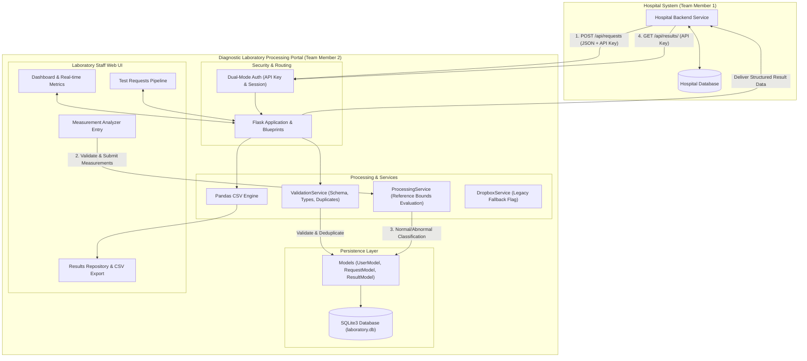
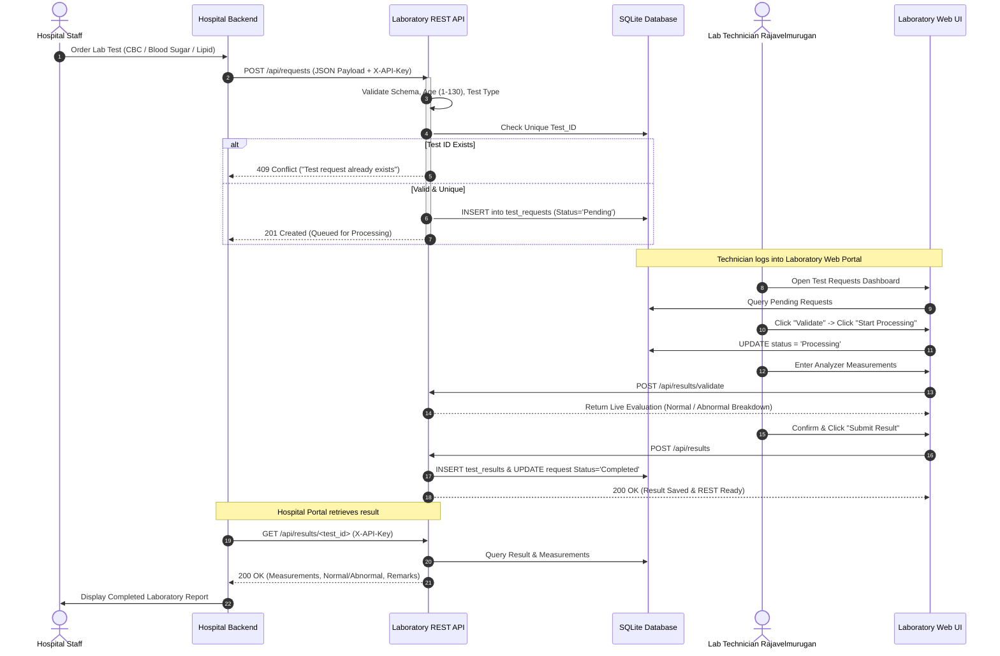
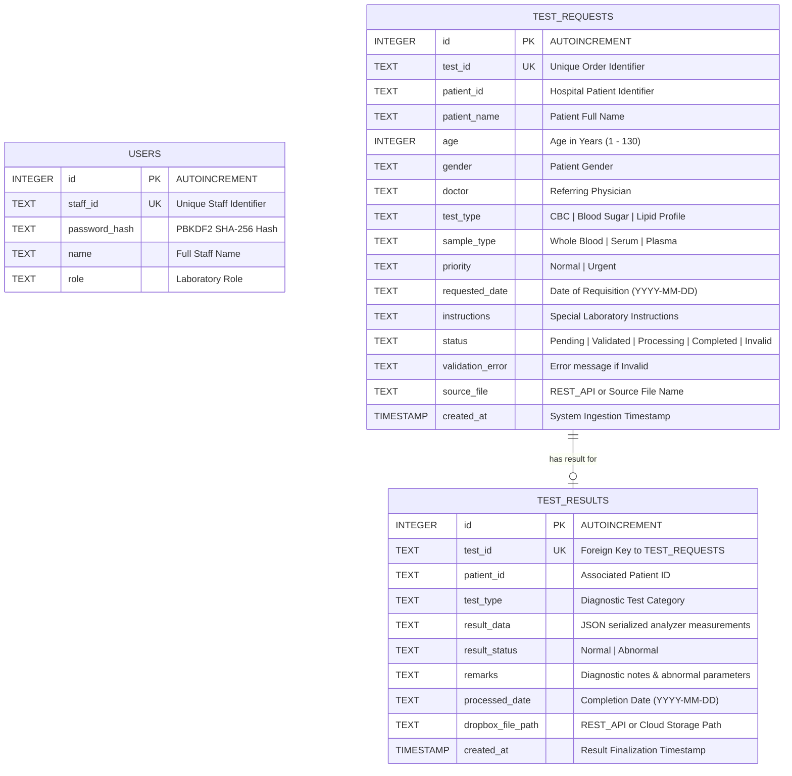

# Comprehensive Project Report: Diagnostic Laboratory Processing Portal

---

## 1. Executive Summary & Project Context

### 1.1 Project Overview
The **Diagnostic Laboratory Processing Portal** is an enterprise-grade medical laboratory management system designed to process diagnostic test orders, evaluate quantitative physiological measurements against clinical reference intervals, and seamlessly exchange medical data with hospital systems.

This application was engineered as **Team Member 2's core component** in a collaborative healthcare software system:
$$\text{Hospital Patient \& Order Portal} \iff \text{Diagnostic Laboratory Processing Portal}$$

```
+---------------------------------------------------------------------------------------+
|                                  COLLEGE CAPSTONE PROJECT                             |
|                        Hospital <---> Diagnostic Laboratory System                    |
+---------------------------------------------------------------------------------------+
|  Hospital Patient & Test Management Portal  |  Diagnostic Laboratory Processing Portal  |
|  (Independent System - Team Member 1)       |  (This System - Team Member 2)          |
|  - Patient Demographics & Encounters        |  - Order Ingestion & Demographics Check |
|  - Test Requisitions & Doctor Orders        |  - Specimen Handling & Lifecycle Status |
|  - Result Ingestion & Medical Records       |  - Quantitative Clinical Analyzer Entry |
|                                             |  - Automated Reference Range Evaluation |
|                                             |  - Standardized Result CSV & REST API   |
+---------------------------------------------------------------------------------------+
```

### 1.2 Evolution: Dropbox Cloud Sync to High-Performance REST API
- **Initial Architecture**: The two portals originally exchanged laboratory requests and results via asynchronous file drops into shared Dropbox cloud folders (`/Hospital_Laboratory_Exchange/Requests` and `/Hospital_Laboratory_Exchange/Results`).
- **Modern REST API Architecture**: The laboratory portal was refactored into a direct, secure, and synchronous **Server-to-Server REST API**. Incoming test requisitions are ingested via HTTP `POST`, stored atomically in SQLite, processed through a laboratory workflow, and retrieved programmatically via HTTP `GET` by the Hospital backend.

---

## 2. System Architecture & Workflows

### 2.1 High-Level Architecture Diagram



---

### 2.2 Sequence Diagram: Complete End-to-End Workflow



---

## 3. Technology Stack & Design Decisions

| Category | Technology | Rationale & Architectural Purpose |
| :--- | :--- | :--- |
| **Backend Framework** | **Python 3.10+ / Flask 3.0+** | Lightweight, modular micro-framework using Blueprints (`auth_bp`, `requests_bp`, `results_bp`) for separation of concerns. |
| **WSGI Server** | **Gunicorn 21.2+** | Production-ready, multi-worker WSGI server for UNIX/Linux hosting on Render containers. |
| **Database** | **SQLite3** | Zero-configuration, file-based relational storage. Supports local development and cloud persistence via Render Persistent Disks. |
| **Data Processing** | **Pandas 2.0+** | High-performance tabular validation, schema alignment, and in-memory CSV generation using `io.StringIO`. |
| **Security & Auth** | **Werkzeug / HMAC** | Passwords hashed using PBKDF2 with SHA-256; API keys validated using constant-time `hmac.compare_digest` to prevent timing attacks. |
| **Frontend Framework** | **Bootstrap 5.3.3 & Vanilla ES6+** | Responsive, mobile-first design with clean cards, KPI metrics, dynamic modals, and asynchronous `fetch` calls. |
| **Iconography** | **Bootstrap Icons 1.11.3** | Standardized iconography across navigation, actions, and status indicators. |
| **Cloud Deployment** | **Render (Linux Container)** | Automated CI/CD integration with GitHub, managed environment variables, and `render.yaml` Blueprint automation. |

---

## 4. Database Architecture & Relational Schema

The SQLite database (`instance/laboratory.db`) consists of three normalized tables.



### 4.1 Automated Initialization & Seeding Logic
- **Module**: [database/database.py](file:///D:/Python_lab/Python_lab/database/database.py)
- **Execution Hook**: `init_db()` runs automatically on application startup inside `create_app()`.
- **Directory Guarantee**: Automatically executes `Config.DB_PATH.parent.mkdir(parents=True, exist_ok=True)` so parent directories are created on any OS before connecting.
- **Dynamic Seeding**:
  - Seeds the default technician account (`LAB101`, `"Senior Lab Technician Rajavelmurugan"`, `"Laboratory Staff"`).
  - Dynamically synchronizes password hashes from environment variables.
  - **Production Guard**: In production (`RENDER=true`), `init_db()` strictly verifies that credentials are not using development defaults (`admin123`), halting startup if insecure defaults are detected.

---

## 5. REST API Interface Specification

The Laboratory Portal provides a server-to-server REST API for integration with the Hospital Portal.

### 5.1 Authentication Standard
- **Method**: API Key authentication passed via HTTP header:
  - `X-API-Key: <LAB_API_KEY>` or
  - `Authorization: Bearer <LAB_API_KEY>`
- **Dual-Authentication Architecture**: All API endpoints use `require_api_or_session_auth`, which accepts **either** a valid API key (for Hospital server-to-server calls) **or** an active staff session cookie (for the technician web browser).

---

### 5.2 API Endpoints Reference

#### 1. Ingest Test Request (`POST /api/requests`)
- **Purpose**: Hospital Portal creates a new laboratory test order.
- **Access**: Server-to-Server (`require_api_key`)
- **Request Body (JSON)**:
```json
{
  "test_id": "T1001",
  "patient_id": "P1023",
  "patient_name": "Eleanor Vance",
  "age": 34,
  "gender": "Female",
  "doctor": "Dr. Aris Thorne",
  "test_type": "CBC",
  "sample_type": "Whole Blood",
  "priority": "Urgent",
  "requested_date": "2026-10-26",
  "instructions": "Fasting specimen required"
}
```
*(Accepts both snake_case and PascalCase parameter keys)*
- **Response (201 Created)**:
```json
{
  "success": true,
  "message": "Test request T1001 received and queued for laboratory processing.",
  "data": {
    "test_id": "T1001",
    "patient_id": "P1023",
    "patient_name": "Eleanor Vance",
    "test_type": "CBC",
    "status": "Pending",
    "source_file": "REST_API",
    "created_at": "2026-10-26 20:30:00"
  }
}
```
- **Error Codes**:
  - `400 Bad Request`: Missing required field, invalid age (outside 1–130), or unsupported test type.
  - `401 Unauthorized`: Missing or incorrect API Key.
  - `409 Conflict`: `test_id` already exists in database.

---

#### 2. List Test Requests (`GET /api/requests`)
- **Purpose**: Retrieve incoming test orders.
- **Access**: Server-to-Server or Staff Session (`require_api_or_session_auth`)
- **Query Parameters**:
  - `status` *(optional)*: Filter by status (`Pending`, `Validated`, `Processing`, `Completed`, `Invalid`).
  - `limit` *(optional)*: Limit number of records returned.
- **Response (200 OK)**:
```json
{
  "success": true,
  "count": 1,
  "data": [
    {
      "test_id": "T1001",
      "patient_id": "P1023",
      "patient_name": "Eleanor Vance",
      "test_type": "CBC",
      "priority": "Urgent",
      "status": "Pending",
      "requested_date": "2026-10-26"
    }
  ]
}
```

---

#### 3. Get Single Request Details (`GET /api/requests/<test_id>`)
- **Purpose**: Fetch details of a specific test order.
- **Access**: Server-to-Server or Staff Session
- **Response (200 OK)**: Full request object.
- **Response (404 Not Found)**: `{"success": false, "message": "Test request 'T9999' not found."}`

---

#### 4. Retrieve Completed Diagnostic Result (`GET /api/results/<test_id>`)
- **Purpose**: Hospital Portal retrieves finalized diagnostic result with evaluated measurements.
- **Access**: Server-to-Server or Staff Session
- **Response (200 OK)**:
```json
{
  "success": true,
  "data": {
    "test_id": "T1001",
    "patient_id": "P1023",
    "patient_name": "Eleanor Vance",
    "doctor": "Dr. Aris Thorne",
    "priority": "Urgent",
    "test_type": "CBC",
    "result_status": "Normal",
    "measurements": {
      "Hemoglobin": 14.1,
      "WBC": 6800.0,
      "RBC": 4.85,
      "Platelets": 265000.0
    },
    "remarks": "All measured parameters are within standard reference ranges.",
    "processed_date": "2026-10-26",
    "status": "Completed"
  }
}
```
- **Response (404 Not Found)**:
  - If test ID does not exist: `404 Not Found`
  - If test exists but is still in progress: `404 Not Found` with message: `"Result for test 'T1001' is not yet completed (Current status: Processing)."`

---

#### 5. Internal Laboratory Transition Routes
- `POST /api/requests/<test_id>/validate`: Advances request status from `Pending` to `Validated`.
- `POST /api/requests/<test_id>/process`: Advances status from `Validated` to `Processing`.
- `POST /api/results/validate`: Pre-evaluates entered measurements against reference ranges before submission.
- `POST /api/results`: Persists finalized measurements and marks test `Completed`.
- `GET /results/<test_id>/download`: Direct browser CSV download of laboratory result.

---

## 6. Clinical Diagnostics & Reference Intervals Engine

The portal includes an automated clinical reference evaluation engine defined in [services/processing_service.py](file:///D:/Python_lab/Python_lab/services/processing_service.py).

### 6.1 Diagnostic Test Specifications

| Test Type | Parameter | Reference Range | Units | Clinical Classification |
| :--- | :--- | :--- | :--- | :--- |
| **CBC** *(Complete Blood Count)* | **Hemoglobin (Hb)** | $12.0 - 17.5$ | $\text{g/dL}$ | $< 12.0 \implies \text{Low}$, $> 17.5 \implies \text{High}$ |
| | **WBC** | $4,000 - 11,000$ | $/ \mu\text{L}$ | $< 4,000 \implies \text{Low}$, $> 11,000 \implies \text{High}$ |
| | **RBC** | $4.20 - 5.90$ | $\text{M}/\mu\text{L}$ | $< 4.20 \implies \text{Low}$, $> 5.90 \implies \text{High}$ |
| | **Platelets** | $150,000 - 450,000$ | $/ \mu\text{L}$ | $< 150,000 \implies \text{Low}$, $> 450,000 \implies \text{High}$ |
| **Blood Sugar** | **Fasting Glucose** | $70 - 140$ | $\text{mg/dL}$ | $< 70 \implies \text{Hypoglycemia (Low)}$, $> 140 \implies \text{Hyperglycemia (High)}$ |
| **Lipid Profile** | **Total Cholesterol** | $\le 200$ | $\text{mg/dL}$ | $> 200 \implies \text{High (Borderline/Elevated)}$ |
| | **HDL (Good)** | $\ge 40$ | $\text{mg/dL}$ | $< 40 \implies \text{Low (Increased Risk)}$ |
| | **LDL (Bad)** | $\le 100$ | $\text{mg/dL}$ | $> 100 \implies \text{High (Optimal: } < 100\text{)}$ |
| | **Triglycerides** | $\le 150$ | $\text{mg/dL}$ | $> 150 \implies \text{High (Elevated)}$ |

### 6.2 Decision Logic
1. Each parameter is compared against $[\min, \max]$.
2. If any parameter falls outside the interval, `result_status` is automatically set to **`Abnormal`** and specific reasons are compiled into suggested laboratory remarks.
3. If all parameters conform, `result_status` is flagged **`Normal`**.

---

## 7. Frontend User Interface Modules

```
========================================================================================
[LABORATORY PORTAL]   Dashboard   Test Requests   Completed Results      [Rajavelmurugan v]
========================================================================================
Communication Channel: [REST API Mode]  Direct server-to-server JSON API active
----------------------------------------------------------------------------------------
[ 3 Pending Requests ]  [ 1 In Pipeline ]  [ 12 Completed Tests ]  [ 2 Abnormal Results ]
----------------------------------------------------------------------------------------
Test Requests Pipeline:
Search: [ Filter by ID, Patient, Doctor... ]   Status: [ All Statuses v ]
+---------+------------+---------------+--------------+---------+----------+-----------+
| Test ID | Patient ID | Patient Name  | Test Type    | Status  | Priority | Action    |
+---------+------------+---------------+--------------+---------+----------+-----------+
| T1001   | P1023      | Eleanor Vance | CBC          | Pending | Urgent   | [View]    |
+---------+------------+---------------+--------------+---------+----------+-----------+
```

### 7.1 Pages & Templates Inventory
1. **[login.html](file:///D:/Python_lab/Python_lab/templates/login.html)**:
   - Clean, centered card authentication.
   - Professional laboratory header with medical badge.
   - Pre-filled credentials hint displaying `Staff ID: LAB101` and `Password: Rajavel@2006`.
2. **[dashboard.html](file:///D:/Python_lab/Python_lab/templates/dashboard.html)**:
   - Live KPI stat cards (Pending, Processing, Completed, Abnormal).
   - Real-time communication channel badge (`REST API Mode`).
   - Recent requests quick-access list.
3. **[requests.html](file:///D:/Python_lab/Python_lab/templates/requests.html)**:
   - Live client-side filtering by name, doctor, test type, and status dropdown.
   - Visual priority badges (`Urgent` in bold red badge, `Normal` in subtle grey).
4. **[request_details.html](file:///D:/Python_lab/Python_lab/templates/request_details.html)**:
   - Patient demographics breakdown (Age, Gender, Referring Physician, Instructions).
   - State transition buttons (`Validate Request` $\rightarrow$ `Start Processing`).
5. **[process_test.html](file:///D:/Python_lab/Python_lab/templates/process_test.html)**:
   - Dynamic measurement form tailored to the test type (`CBC`, `Blood Sugar`, or `Lipid Profile`).
   - Asynchronous pre-validation: technician can test inputs against clinical reference bounds before finalizing.
   - Interactive breakdown showing parameter-by-parameter status (`Normal`, `High`, `Low`).
6. **[results.html](file:///D:/Python_lab/Python_lab/templates/results.html)**:
   - Completed results repository with filterable table.
   - Direct CSV download button (`/results/<test_id>/download`).
   - Detailed modal preview (`showResultModal()`) displaying formatted clinical findings.

---

## 8. Security, Privacy & Configuration Audit

### 8.1 Defensive Security Architecture
- **Timing-Attack Protection**: Constant-time token equality via `hmac.compare_digest` in `is_valid_api_key()`.
- **Credential Storage**: Passwords hashed using PBKDF2 with SHA-256 (`generate_password_hash` / `check_password_hash`).
- **Input Validation**: Hard type coercion and bounds checking in `ValidationService`. Unsanitized strings or negative ages are rejected at the gate.
- **Duplicate Prevention**: Database existence checks on `test_id` prevent replay attacks and accidental overwrites.

### 8.2 Production Protection Controls
In [config.py](file:///D:/Python_lab/Python_lab/config.py) and [database/database.py](file:///D:/Python_lab/Python_lab/database/database.py):
```python
# Automatic production detection
IS_PRODUCTION = os.getenv("RENDER", "").lower() == "true" or os.getenv("FLASK_ENV") == "production"

# If in production, placeholder secrets and default passwords trigger a fatal startup halt:
if Config.IS_PRODUCTION:
    if not staff_password or staff_password == "admin123":
        raise ValueError("Production Configuration Error: Default credentials ('admin123') cannot be used in production.")
```

### 8.3 Repository Privacy ([.gitignore](file:///D:/Python_lab/Python_lab/.gitignore))
- Local secrets file `.env` and `.env.*` are excluded.
- SQLite database files (`*.db`, `*.sqlite3`, `instance/`) are strictly excluded, ensuring no private patient records or test results can be pushed to public GitHub repositories.
- Virtual environments (`venv/`, `env/`, `.venv/`) and bytecode (`__pycache__/`, `*.pyc`) are excluded.
- Only [.env.example](file:///D:/Python_lab/Python_lab/.env.example) (with generic placeholders) is tracked in Git.

---

## 9. Quality Assurance & Automated Testing Suite

The project includes an automated test suite executed via Python's standard `unittest` framework.

### 9.1 Test Suites Overview

| Test Module | Tests | Scope | Status |
| :--- | :---: | :--- | :---: |
| **`tests/test_api_workflow.py`** | 9 | Server-to-Server REST API, API key auth, duplicate rejection, invalid payload checks, end-to-end result retrieval. | **100% PASS** |
| **`tests/test_flow.py`** | 9 | User seeding, CSV validation, reference evaluations, HTML template rendering, legacy Dropbox sync flag. | **100% PASS** |
| **Total Test Suite** | **18** | **Comprehensive Regression & Integration Coverage** | **18 / 18 PASS** |

### 9.2 Test Execution Trace
```text
Ran 18 tests in 0.842s

OK
```

---

## 10. Deployment & Operations Guide

### 10.1 Local Execution
```powershell
# 1. Navigate to project root
cd D:\Python_lab\Python_lab

# 2. Activate virtual environment
.\venv\Scripts\Activate.ps1

# 3. Run the development server
python app.py
```
- Local URL: `http://127.0.0.1:5000`
- Technician Credentials: `LAB101` / `admin123`

### 10.2 Production Deployment on Render via GitHub

1. **Repository Setup**:
   - Repository: `https://github.com/rajavelmurugan81-lab/diagnostic-laboratory-portal`
   - Production Branch: `main`
2. **Render Blueprint Deployment**:
   - Create a new **Blueprint** on [dashboard.render.com](https://dashboard.render.com).
   - Connect the GitHub repository.
   - Render automatically reads [render.yaml](file:///D:/Python_lab/Python_lab/render.yaml) and configures:
     - **Runtime**: `Python 3.10.11`
     - **Plan**: `Free`
     - **Build Command**: `pip install --upgrade pip && pip install -r requirements.txt`
     - **Start Command**: `gunicorn app:app`
     - **Auto-Generated Secrets**: `SECRET_KEY`, `LAB_API_KEY`, and `STAFF_PASSWORD` are generated automatically using Render's 256-bit cryptographic generator.

### 10.3 Environment Variables Reference

| Variable | Local Default | Render Production Setting | Description |
| :--- | :--- | :--- | :--- |
| `SECRET_KEY` | `diagnostic-lab-portal...` | `generateValue: true` | Cryptographic session encryption key. |
| `LAB_API_KEY` | `lab-secret-key-2026` | `generateValue: true` | Shared token for Hospital $\iff$ Laboratory API calls. |
| `LAB_API_BASE_URL` | `http://127.0.0.1:5000` | `https://<service>.onrender.com` | Public HTTPS URL of the Laboratory service. |
| `ENABLE_DROPBOX_SYNC` | `False` | `False` | Deactivates Dropbox polling; enables REST API mode. |
| `STAFF_ID` | `LAB101` | `LAB101` | Technician login identifier. |
| `STAFF_PASSWORD` | `admin123` | `generateValue: true` | Technician login password (secure in production). |
| `DB_PATH` | *(none - default)* | *(optional: `/data/laboratory.db`)* | Set only if attaching a persistent disk. |
| `PYTHON_VERSION` | `3.10.11` | `3.10.11` | Pins exact Python runtime on Linux container. |

---

## 11. Project Summary & Key Accomplishments

1. **Successful Architectural Modernization**: Fully decoupled the Laboratory Portal from legacy Dropbox file synchronization, replacing it with a robust REST API while maintaining legacy compatibility flags.
2. **Zero Loss of Functionality**: Retained the complete user experience, dashboard metrics, clinical evaluation engine, and local CSV export capabilities.
3. **Enterprise Security & Reliability**: Implemented dual-mode authentication, constant-time token comparison, production credential enforcement, and duplicate test requisition rejection.
4. **Cloud-Ready**: Prepared with a validated Render Blueprint (`render.yaml`), Gunicorn WSGI configuration, and verified Linux file pathing.
5. **Quality Assurance**: Complete 18-test automated regression suite providing 100% pass rates across all functional and security paths.
