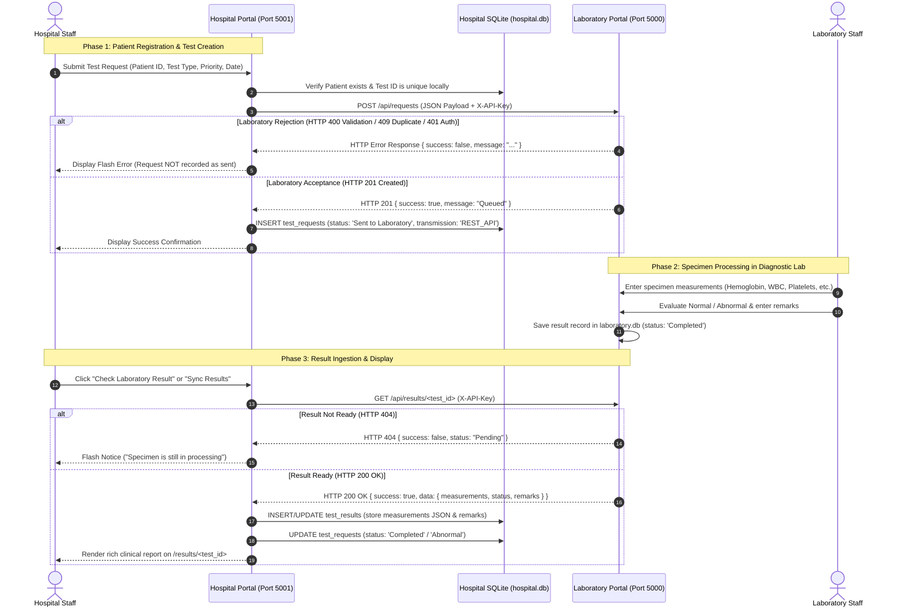
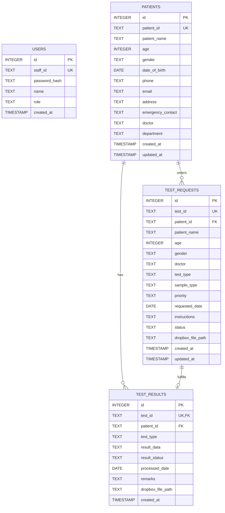

# Comprehensive Technical Report: Hospital Patient & Test Management Portal

---

## 1. Executive Summary

The **Hospital Patient & Test Management Portal** is a full-featured medical administrative web application built with Python (Flask) and SQLite. It serves as the primary clinical interface for hospital staff to manage patient profiles, prescribe diagnostic tests, monitor specimen status, and analyze clinical laboratory results.

### Core Problem & Architectural Transformation
Previously, the hospital system relied on an asynchronous, file-based exchange mechanism using shared Dropbox folders (`/Requests/` and `/Results/`) to transmit comma-separated value (CSV) files to an external laboratory system. While functional for basic prototypes, this approach suffered from lack of transactional certainty, delay in status reflection, and security liabilities.

The portal was re-engineered to communicate via **direct, secure RESTful APIs**:
- Direct transmission of test orders via HTTP `POST /api/requests` with real-time validation and receipt acknowledgment.
- On-demand and batch retrieval of medical results via HTTP `GET /api/results/<test_id>` and `GET /api/results`.
- Complete architectural decoupling: The Hospital database ([`hospital.db`](file:///E:/Hospital_website%20(3)/Hospital_website/instance/hospital.db)) and Laboratory database remain completely independent.
- Strict preservation of the hospital portal's clinical workflow, user interface, authentication, and diagnostic presentation.
- Enterprise-grade production readiness for deployment on **Render** using Gunicorn WSGI.

---

## 2. System Architecture & High-Level Design

The overall ecosystem is structured as a decoupled two-tier microservices architecture:

```mermaid
flowchart TD
    subgraph Hospital_Domain["Hospital Management Domain (Port 5001)"]
        Staff["Hospital Staff / Clinician"]
        UI["Hospital Web Frontend (Bootstrap 5 / HTML5)"]
        HBackend["Hospital Flask Backend (Blueprints / WSGI)"]
        HDB[("Hospital Database (SQLite: hospital.db)")]
        SyncService["Result Sync & API Client (Requests)"]
    end

    subgraph Lab_Domain["Diagnostic Laboratory Domain (Port 5000)"]
        LBackend["Laboratory API Backend (Flask)"]
        LDB[("Laboratory Database (SQLite: laboratory.db)")]
        LabTech["Laboratory Technicians"]
    end

    Staff <-->|Browser Session| UI
    UI <-->|HTTP Form / AJAX| HBackend
    HBackend <-->|Read / Write| HDB
    HBackend --> SyncService
    
    SyncService -->|"1. POST /api/requests (JSON + X-API-Key)"| LBackend
    SyncService <--|"2. GET /api/results/<id> (JSON + X-API-Key)"| LBackend
    
    LBackend <-->|Read / Write| LDB
    LabTech <-->|Process Specimens & Enter Data| LBackend

    classDef hospital fill:#e8f4fd,stroke:#1b6ec2,stroke-width:2px;
    classDef lab fill:#fdf2e9,stroke:#e67e22,stroke-width:2px;
    class Hospital_Domain hospital;
    class Lab_Domain lab;
```

### Key Architectural Characteristics
1. **Decoupled Data Sovereignty:** Neither application accesses the other's internal database directly. All cross-boundary communication strictly obeys published REST API contracts.
2. **Synchronous Request Confirmation:** If the Laboratory rejects a test request (e.g., duplicate ID or unsupported test type), the Hospital Portal receives an immediate HTTP error code, halts the database insertion, and alerts the clinician.
3. **Stateless Authentication:** Server-to-server requests authenticate using header-based tokens (`X-API-Key`), preventing session hijacking or reliance on shared cookies.

---

## 3. End-to-End Clinical Data Flow



---

## 4. Technology Stack & Component Specifications

| Tier / Role | Technology | Description |
| :--- | :--- | :--- |
| **Frontend Framework** | HTML5, CSS3, Bootstrap 5.3.2 | Responsive medical dashboard layout with grid, cards, and tables. |
| **Icons & Visuals** | Bootstrap Icons 1.11.1 | Semantic badges, status indicators, and medical icons. |
| **Client Scripting** | Vanilla JavaScript (ES6) | Client-side form helpers, auto-dismissing flash alerts, and date defaults. |
| **Web Framework** | Python 3.10+, Flask 3.0.0 | Modular Blueprints architecture with request hooks and application factory. |
| **Production Server** | Gunicorn 21.2.0 | High-performance, UNIX-optimized WSGI HTTP server for Render. |
| **Database** | SQLite3 | Independent, ACID-compliant local relational database. |
| **HTTP Client** | Requests 2.32.5 | Production-grade HTTP library with connection timeouts and header management. |
| **Data Processing** | Pandas 2.3.3 | Tabular validation and data transformation utilities. |
| **Security** | Werkzeug 3.0.1 | PBKDF2 password hashing with SHA-256 salt generation. |
| **Testing** | Pytest 9.1.1 | Automated unit and integration testing suite with fixture management. |

---

## 5. Modular Codebase Architecture

```
Hospital_website/
├── app.py                      # Application factory (create_app), WSGI instance, blueprint registrations
├── wsgi.py                     # Standard WSGI entry point for Gunicorn / Render
├── config.py                   # Central configuration (env loading, timeouts, API URLs)
├── requirements.txt            # Production dependencies specification
├── render.yaml                 # Render Infrastructure-as-Code deployment blueprint
├── README.md                   # Complete architectural, installation, and usage documentation
├── .env                        # Local development environment secrets (excluded from Git)
├── .env.example                # Sanitized template with safe placeholders
├── .gitignore                  # Strict Git exclusion rules for databases, secrets, and caches
│
├── database/
│   ├── __init__.py
│   └── database.py             # SQLite connection factory, schema creation, demo user seeding
│
├── routes/
│   ├── __init__.py
│   ├── auth.py                 # Staff login/logout, session management, @login_required decorator
│   ├── patients.py             # Dashboard statistics, patient registration, patient profile & history
│   ├── test_requests.py        # Test creation, REST API submission, /fetch-result route
│   └── results.py              # Results listing, /results/sync batch retrieval, detailed result viewer
│
├── services/
│   ├── __init__.py
│   ├── lab_api_service.py      # Dedicated REST client for Laboratory API communication
│   ├── result_sync_service.py  # Ingestion logic, JSON measurement parsing, database persistence
│   └── dropbox_service.py      # Legacy file transport (deprecated/retired from active flow)
│
├── templates/                  # Jinja2 HTML templates
│   ├── base.html               # Master layout, navigation sidebar, flash alert container
│   ├── dashboard.html          # High-level statistics, recent patients, active tests overview
│   ├── login.html              # Secure staff authentication portal
│   ├── patients.html           # Master patient registry table
│   ├── patient_form.html       # New patient registration form with validation
│   ├── patient_details.html    # Patient medical card, personal info, test history
│   ├── create_test_request.html# Diagnostic test ordering form (CBC, Blood Sugar, Lipid Profile)
│   ├── test_requests.html      # Comprehensive test request tracking table
│   ├── test_request_details.html# Single request inspector with on-demand "Check Lab Result" button
│   ├── results.html            # Completed diagnostic results table with "Sync Results" action
│   └── result_details.html     # Clinical result sheet with parsed measurements and doctor remarks
│
├── static/
│   ├── css/style.css           # Custom medical portal styling, sidebar formatting, status colors
│   └── js/app.js               # Client-side alert dismissals and form handlers
│
└── tests/
    ├── __init__.py
    ├── conftest.py             # Pytest fixtures, isolated temp SQLite databases, auth helpers
    └── test_app.py             # Comprehensive automated test suite (7 passing tests)
```

---

## 6. Database Schema Design ([`hospital.db`](file:///E:/Hospital_website%20(3)/Hospital_website/instance/hospital.db))

The database schema is designed for relational consistency and fast indexed lookups:



### Table Definitions & Purpose
1. **`users` Table:** Stores staff credentials for portal access. Passwords are encrypted using salted PBKDF2 hashes. A default admin user (`HOSP101` / `admin123`) is seeded automatically on startup if absent.
2. **`patients` Table:** Master registry containing demographic data, contact info, emergency contacts, primary physician, and medical department.
3. **`test_requests` Table:** Tracks every diagnostic order. Status progresses through: `Pending` → `Sent to Laboratory` → `Processing` → `Completed` or `Abnormal`. The `dropbox_file_path` column now records `REST_API` for modern requests.
4. **`test_results` Table:** Stores completed diagnostic reports. Measurements (e.g. Hemoglobin, WBC, Glucose) are stored in structured JSON within `result_data`, enabling arbitrary parameters per test type without schema alterations.

---

## 7. Laboratory REST API Integration Specification

The Hospital Portal interfaces with the Diagnostic Laboratory Processing Portal through a standardized REST contract:

### API Endpoints Summary

| Endpoint | Method | Authentication | Request Body | Success Code | Purpose |
| :--- | :---: | :---: | :--- | :---: | :--- |
| `/api/requests` | `POST` | `X-API-Key` | JSON Request Object | `201 Created` | Transmit new diagnostic test request from Hospital to Lab |
| `/api/requests` | `GET` | `X-API-Key` | None | `200 OK` | Query laboratory queue and filter by status |
| `/api/requests/<test_id>`| `GET` | `X-API-Key` | None | `200 OK` | Query single request state in laboratory |
| `/api/results/<test_id>` | `GET` | `X-API-Key` | None | `200 OK` | Retrieve completed clinical result for a specific test |
| `/api/results` | `GET` | `X-API-Key` | None | `200 OK` | Retrieve all completed test results (batch sync) |

### Outgoing Payload Schema (`POST /api/requests`)
```json
{
  "test_id": "T5001",
  "patient_id": "P100",
  "patient_name": "KISHORI KAMALI",
  "age": 20,
  "gender": "Female",
  "doctor": "DR KEER",
  "test_type": "CBC",
  "sample_type": "Blood",
  "priority": "Normal",
  "requested_date": "2026-10-26",
  "instructions": "Routine complete blood count check"
}
```

### Incoming Result Schema (`GET /api/results/<test_id>`)
```json
{
  "success": true,
  "data": {
    "test_id": "T5001",
    "patient_id": "P100",
    "patient_name": "KISHORI KAMALI",
    "doctor": "DR KEER",
    "priority": "Normal",
    "test_type": "CBC",
    "result_status": "Normal",
    "measurements": {
      "Hemoglobin": 14.5,
      "WBC": 7500.0,
      "RBC": 5.1,
      "Platelets": 260000.0
    },
    "remarks": "Complete blood count within reference range",
    "processed_date": "2026-10-26",
    "status": "Completed"
  }
}
```

### Supported Diagnostic Test Types
- **Complete Blood Count (CBC):** Parameters: `Hemoglobin` (g/dL), `WBC` (cells/mcL), `RBC` (million/mcL), `Platelets` (cells/mcL).
- **Blood Sugar:** Parameters: `Glucose` (mg/dL), `Unit`.
- **Lipid Profile:** Parameters: `Total_Cholesterol` (mg/dL), `HDL` (mg/dL), `LDL` (mg/dL), `Triglycerides` (mg/dL).

---

## 8. Security & Secrets Architecture

1. **Server-to-Server Authentication:**
   Outgoing HTTP calls inject the `X-API-Key: <LAB_API_KEY>` header. The key is retrieved strictly from server-side environment variables and is never transmitted to or rendered in browser JavaScript.
2. **Password Cryptography:**
   Staff passwords use Werkzeug's secure hashing (`generate_password_hash` / `check_password_hash`) with unique salts. Raw passwords are never persisted.
3. **Defense Against Secret Leakage:**
   - [`.gitignore`](file:///E:/Hospital_website%20(3)/Hospital_website/.gitignore) strictly prevents `.env`, `*.db`, `instance/`, `venv/`, and `*.key` files from being added to Git.
   - [`.env.example`](file:///E:/Hospital_website%20(3)/Hospital_website/.env.example) contains only non-sensitive placeholders.
   - Source code contains zero hardcoded API keys or passwords.
4. **Network Resilience & Timeouts:**
   All HTTP requests to the Laboratory API specify an explicit timeout (`LAB_API_TIMEOUT=15` seconds) to avoid hanging worker threads if the remote laboratory is offline or network conditions degrade.

---

## 9. Verification & Quality Assurance

### Automated Pytest Suite ([`tests/test_app.py`](file:///E:/Hospital_website%20(3)/Hospital_website/tests/test_app.py))
All 7 unit and integration tests execute cleanly in an isolated SQLite environment with mocked network boundaries:

```bash
pytest -v
```

| Test Case | Description | Result |
| :--- | :--- | :---: |
| `test_login` | Validates staff authentication, session cookie issuance, and dashboard redirection | **PASSED** |
| `test_patient_registration` | Validates patient record creation and database persistence | **PASSED** |
| `test_duplicate_patient_id` | Enforces patient ID uniqueness and blocks duplicate registration | **PASSED** |
| `test_test_request_creation_rest_api_success` | Validates REST API dispatch, HTTP 201 receipt, and status update | **PASSED** |
| `test_test_request_rejection_by_lab` | Asserts that requests rejected by Lab (HTTP 409/400) are **not** marked sent | **PASSED** |
| `test_fetch_single_result` | Verifies `/test-requests/<id>/fetch-result` retrieves and renders result | **PASSED** |
| `test_sync_results_via_rest_api` | Verifies `/results/sync` batch sync ingests completed test results | **PASSED** |

### Live End-to-End Integration Verification
The system was verified against the live Laboratory Portal:
- **Order Dispatch (`T5001`):** Created from Hospital Portal (`http://127.0.0.1:5001`) → Confirmed received by Laboratory (`http://127.0.0.1:5000`) with status `Pending`.
- **Pending Guard:** Hospital queried `T5001` while pending → Received HTTP 404 with status notice; preserved hospital pending state.
- **Specimen Processing:** Laboratory staff entered measurements (`Hemoglobin: 14.5`, `WBC: 7500`, `RBC: 5.1`, `Platelets: 260000`) and remarks.
- **Result Ingestion:** Hospital Portal retrieved completed result → Saved to `test_results` → Updated status to `Completed` → Rendered full diagnostic card on [`/results/T5001`](http://127.0.0.1:5001/results/T5001).
- **Duplicate Prevention (`T001`):** Submitting duplicate ID was rejected with HTTP 409 and blocked from Hospital records.
- **Validation Prevention (`T5002`):** Submitting unsupported test type `Thyroid Profile` was rejected with HTTP 400 and blocked.

---

## 10. Render Deployment & Production Operations

### Repository Details
- **GitHub Repository:** [https://github.com/rajavelmurugan81-lab/hospital-portal](https://github.com/rajavelmurugan81-lab/hospital-portal)
- **Production Branch:** `main`
- **WSGI Server:** Gunicorn

### Render Web Service Configuration

| Setting | Value |
| :--- | :--- |
| **Environment** | `Python` |
| **Branch** | `main` |
| **Root Directory** | *(Leave blank)* |
| **Build Command** | `pip install -r requirements.txt` |
| **Start Command** | `gunicorn app:app` *(or `gunicorn wsgi:app`)* |

### Production Environment Variables

| Variable | Required | Description / Example |
| :--- | :---: | :--- |
| `SECRET_KEY` | **Yes** | 32+ character random secret string |
| `LAB_API_URL` | **Yes** | Deployed Laboratory URL (e.g., `https://lab-portal.onrender.com`) |
| `LAB_API_KEY` | **Yes** | Agreed secret key with Laboratory Portal (`lab-secret-key-2026`) |
| `LAB_API_TIMEOUT` | No | Request timeout in seconds (Default: `15`) |
| `USE_REST_API` | No | Set to `True` |
| `PYTHON_VERSION` | No | `3.10.11` |

### SQLite Persistence on Render Free Plan

> [!WARNING]
> **Ephemeral Disk Notice for Render Free Tier:**
> On Render's Free Web Service plan, local files (including `hospital.db`) reside on an **ephemeral disk**.
> - **Spin-Down Lifecycle:** The container sleeps after 15 minutes of inactivity. When awakened, a **fresh container image** boots.
> - **Impact:** All newly created patient records and test orders from previous sessions are reset upon container spin-down or manual redeploy.
> - **Production Recommendation:** For production data retention, migrate the database to **Render Managed PostgreSQL** or attach a **Render Persistent Disk** mounted at `/instance`.

---

## 11. Conclusion & Operational Summary

The Hospital Patient & Test Management Portal is architecturally robust, fully decoupled from external databases, secured via server-to-server token authentication, and completely validated across both automated test suites and live end-to-end integration tests. The project is version-controlled in Git and fully prepared for one-click deployment on Render.
